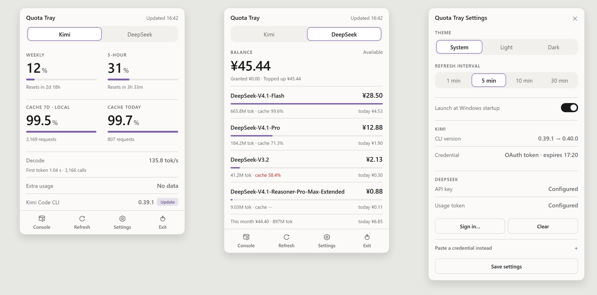
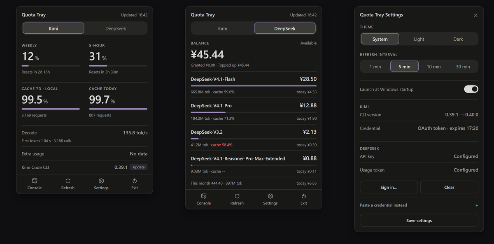

# Quota Tray

One tray icon for two quotas: **Kimi Code** plan usage and **DeepSeek** balance,
in a single 424 px panel with a provider tab. Windows 10/11, no installer, no
account of its own, no telemetry.

English | [中文](#中文)

| Light | Dark |
| --- | --- |
|  |  |

Screenshots are generated from the shipped markup and stylesheets by
`demo/make_readme_shots.py`; the values are a snapshot, the layout is the product's.

## What it shows

**Kimi** — the two plan windows (`weekly`, `5-hour`) with a percentage, a
progress bar and a reset countdown (`Resets in 2d 18h`); the Extra Usage wallet
(`Not activated` when the plan reports `isEnabled: false`); the Kimi Code CLI
version with an `Update` badge when a newer release exists; and a local
cache/decode block: cache hit rate for the last 7 days and for today, request
counts, decode speed and mean time to first token.

**DeepSeek** — account balance (`Available` / `Insufficient balance`, granted
and topped-up amounts), one row per model with this month's cost, a token-share
bar, the cache hit rate and today's cost, then a month total. The top four
models by month cost are shown. A cache hit rate under 60%, or a balance under
¥10, turns red.

Both tabs share one panel: the tab you pick is remembered (`ActiveTab` in
`settings.json`), and the window resizes to its content, anchored to the
bottom-right corner.

## Requirements

- Windows 10 or 11, x64. The WebView2 runtime is required (preinstalled on
  Windows 11 and current Windows 10).
- **Kimi tab**: the Kimi Code CLI, signed in on the same machine — the app reads
  its OAuth token from `~/.kimi-code/`.
- **DeepSeek tab**: a DeepSeek API key (for the balance) and/or a signed-in
  console session (for usage). Either can be entered from the settings window;
  the `Sign in…` window is the easiest way, and the fallback is a paste field.

## Install

Download `QuotaTray.exe` from [Releases](../../releases), put it anywhere and
run it. It is a single portable exe — no installer, no service, no admin rights.

- **Portable mode**: create an empty `portable.dat` next to the exe and every
  setting, credential and cache stays in that folder instead of `%APPDATA%\QuotaTray`.
- **Start with Windows**: *Settings → Launch at Windows startup* writes a value
  under `HKCU\Software\Microsoft\Windows\CurrentVersion\Run` — user scope only.
- The exe is unsigned, so SmartScreen may warn on first launch
  (*More info → Run anyway*).

## Where the numbers come from

| Data | Source |
| --- | --- |
| Kimi plan windows, Extra Usage | `GET https://api.kimi.com/coding/v1/usages` with the Kimi Code OAuth token |
| Kimi cache / decode | this machine's CLI session logs (`~/.kimi-code/sessions/…`), hence the `local` label |
| Kimi CLI version | `kimi --version`, plus the official changelog for the update badge |
| DeepSeek balance | `GET https://api.deepseek.com/user/balance` with the API key |
| DeepSeek usage | the platform console's usage endpoint, with the browser token captured by the sign-in window |
| DeepSeek model names | `GET https://api.deepseek.com/models` (falls back to a built-in table, then to the raw id) |

The two providers use different scopes and the panel says so: DeepSeek usage is
account-wide (the console aggregates it), while Kimi's cache/decode numbers are
local to this machine. The Kimi quota API carries no token data at all.

## Privacy

- The Kimi token is read-only and is sent only to `api.kimi.com`, as a Bearer token.
- DeepSeek credentials live in `%APPDATA%\QuotaTray\deepseek-credentials.json`
  (or beside the exe in portable mode). Values are encrypted with Windows DPAPI
  and sealed behind a `dpapi:` prefix; key names stay readable. A credential set
  captured by another Windows account does not decrypt, which is intended.
- The `Sign in…` window loads `platform.deepseek.com` in a temporary WebView2
  window and gives that page **no** Tauri IPC surface: the only thing leaving it
  is a cancelled navigation carrying a candidate token, which is verified with a
  real request before it replaces the stored one.
- Nothing is logged beyond local diagnostics: `webview.log` and the Kimi usage
  index record counts and states, never tokens, keys or message content. The app
  talks only to `api.kimi.com`, `api.deepseek.com` and `platform.deepseek.com`,
  and the GitHub API when checking for CLI updates. There is no telemetry
  endpoint.

## Command line

The self-checks run **before** the single-instance mutex, so they work next to
a live tray instance:

| Command | What it prints |
| --- | --- |
| `QuotaTray.exe --test-fetch` | Kimi quota once, JSON on stdout |
| `QuotaTray.exe --test-deepseek [--verbose]` | DeepSeek balance + usage once as JSON; `--verbose` adds endpoint/credential-source/aggregation diagnostics on stderr |
| `QuotaTray.exe --test-update` | one line: `local=… latest=… updateAvailable=… checkFailed=…` |
| `QuotaTray.exe --test-usage` | Kimi local usage aggregated twice (tree walk, then stat-only) — the two request counts must match |
| `QuotaTray.exe --test-ui` | builds every window and prints `… OK` lines |
| `QuotaTray.exe --test-login [--verbose]` | credential source, a real token verification and a probe through the sign-in window's capture channel |

None of them prints a token or an API key. Set `QUOTA_TRAY_APP_DATA_DIR` to run
an isolated instance that never touches your real settings.

## Build from source

Prerequisites: Node 22+, Rust stable (MSVC toolchain), Visual Studio C++ build
tools, WebView2 runtime.

```bash
npm install
npm run dev              # Vite only (frontend)
npx tauri dev            # the full app
npx tauri build          # release exe in src-tauri/target/release/quota-tray.exe
npx tsc --noEmit         # npm run build does no type checking
cargo test --manifest-path src-tauri/Cargo.toml   # pure logic only
```

A debug `cargo build` does not embed the frontend (it points at the Vite dev
server), so only `npx tauri dev` or a release build renders the UI; the
`--test-*` flags work either way.

```bash
PYTHONUTF8=1 python demo/build_ui_demo.py   # every window on one page
PYTHONUTF8=1 python demo/make_readme_shots.py  # the screenshots above
```

## Repository layout

| Path | Contents |
| --- | --- |
| `src/` | vanilla TS/HTML/CSS frontend, one entry per window (`main`, `settings`, `skills`, `menu`) |
| `src-tauri/src/` | Rust backend: credentials, quota, DeepSeek client/parser, pollers, tray, windows, WebView2 recovery |
| `src-tauri/tests/fixtures/` | inert DeepSeek payloads the parser tests assert against |
| `docs/` | inherited behaviour spec (`SPEC.md` / `SPEC_EN.md`), screenshots |
| `demo/` | frozen design references and zero-dependency review tooling (all-windows page, height and contrast checks, icon generation) |
| `PLAN.md` | design and behaviour contract; `STATUS.md` is the progress snapshot |

## Limitations

- Windows only. The tray menu, the DPAPI storage and the WebView2 sign-in window
  are all Windows-specific by design.
- DeepSeek usage comes from the platform console's internal endpoint, not from a
  documented API. When that shape or path moves, the app falls back through a
  candidate list, learns the new endpoint from the sign-in window, and otherwise
  shows a visible failure rather than wrong numbers.
- The DeepSeek balance needs an API key: signing in to the console does not
  expose it.
- A failed fetch keeps the last good values and shows `Fetch failed`; there are
  no error dialogs anywhere.

## License and attribution

MIT — see [LICENSE](LICENSE). Quota Tray merges two earlier MIT projects
(`kimi-planbar-tray` and `deepseek-planbar`); the attribution chain is in
[NOTICE](NOTICE). It is an unofficial tool and is not affiliated with Kimi
(Moonshot AI) or DeepSeek.

---

## 中文

一个托盘图标，两块额度：**Kimi Code** 套餐用量与 **DeepSeek** 余额，收在同一个
424 px 面板里，用 tab 切换。Windows 10/11，免安装，不自建账号，无遥测。

上图的截图由 `demo/make_readme_shots.py` 从产品自身的 HTML/CSS 生成——数值是快照，
布局就是产品本身。

### 显示内容

**Kimi** —— 套餐的两个窗口（`weekly` / `5-hour`）：百分比、进度条、重置倒计时
（`Resets in 2d 18h`）；Extra Usage 钱包（套餐报 `isEnabled: false` 时显示
`Not activated`）；Kimi Code CLI 版本，有新版本时带 `Update` 标记；以及一块本机
缓存 / 解码读数：最近 7 天与今天的缓存命中率、请求数、解码速度、平均首 token 耗时。

**DeepSeek** —— 账户余额（`Available` / `Insufficient balance`，以及 Granted 与
Topped up 金额）；每个模型一行，含本月消费、token 份额条、缓存命中率与今日消费；
末行为本月合计。只显示本月消费最高的前 4 个模型。缓存命中率低于 60% 或余额低于
¥10 时标红。

两个 tab 共用一个面板：选中的 tab 会记住（`settings.json` 的 `ActiveTab`），
窗口高度随内容变化，右下角锚定。

### 运行要求

- Windows 10 / 11 x64，需要 WebView2 运行时（Win11 与较新的 Win10 已自带）。
- **Kimi 页**：本机装好并已登录 Kimi Code CLI——程序从 `~/.kimi-code/` 读它的
  OAuth token。
- **DeepSeek 页**：DeepSeek API Key（查余额）和/或已登录的网页会话（查用量）。
  两者都能在设置窗里填写；最省事的是点 `Sign in…` 开登录窗，兜底是手工粘贴。

### 安装

从 [Releases](../../releases) 下载 `QuotaTray.exe`，放到任意目录直接运行。
单文件绿色版：没有安装器、没有服务、不需要管理员权限。

- **便携模式**：在 exe 同级放一个空的 `portable.dat`，设置、凭证与缓存就都留在
  该目录，不写 `%APPDATA%\QuotaTray`。
- **开机自启**：*Settings → Launch at Windows startup* 只写
  `HKCU\Software\Microsoft\Windows\CurrentVersion\Run`，仅当前用户。
- exe 未签名，首次运行 SmartScreen 可能提示（*More info → Run anyway*）。

### 数据来源

| 数据 | 来源 |
| --- | --- |
| Kimi 套餐窗口、Extra Usage | `GET https://api.kimi.com/coding/v1/usages`，带 Kimi Code OAuth token |
| Kimi 缓存 / 解码 | 本机 CLI 会话日志（`~/.kimi-code/sessions/…`），所以标签写 `local` |
| Kimi CLI 版本 | `kimi --version`，更新标记来自官方 changelog |
| DeepSeek 余额 | `GET https://api.deepseek.com/user/balance`，带 API Key |
| DeepSeek 用量 | 平台控制台的用量接口，带登录窗捕获的浏览器 token |
| DeepSeek 模型名 | `GET https://api.deepseek.com/models`（拿不到时回落内置表，再回落原始 id） |

两边的口径不同，界面上也写明了：DeepSeek 用量是**账号级**（平台控制台聚合），
Kimi 的缓存 / 解码是**本机**数字。Kimi 的额度接口本身没有任何 token 数据。

### 隐私

- Kimi token 只读，只发给 `api.kimi.com`（Bearer）。
- DeepSeek 凭证存在 `%APPDATA%\QuotaTray\deepseek-credentials.json`（便携模式则在
  exe 同级），值用 Windows DPAPI 加密、以 `dpapi:` 前缀标记，键名保持可读。
  换个 Windows 账号拷过去解不开——这是有意的。
- `Sign in…` 窗加载 `platform.deepseek.com`，是临时窗口，且**不给该页面任何 Tauri
  IPC 命令面**：离开页面的只有一次被取消的导航，携带候选 token，且必须先通过一次
  真实请求验证才会替换已存凭证。
- 不记录 token、密钥、对话内容：`webview.log` 与本机用量索引只有计数与状态，
  里面没有它们，`--test-*` 也只打印状态。
  程序只访问 `api.kimi.com`、`api.deepseek.com`、`platform.deepseek.com`，以及
  检查 CLI 版本时的 GitHub API，没有遥测端点。

### 命令行自检

这些参数在单实例互斥锁**之前**处理，所以托盘里已有实例时也能跑：

| 命令 | 输出 |
| --- | --- |
| `QuotaTray.exe --test-fetch` | 拉一次 Kimi 额度，JSON 到 stdout |
| `QuotaTray.exe --test-deepseek [--verbose]` | 拉一次 DeepSeek 余额与用量，JSON；`--verbose` 把端点、凭证来源、聚合过程打到 stderr |
| `QuotaTray.exe --test-update` | 一行：`local=… latest=… updateAvailable=… checkFailed=…` |
| `QuotaTray.exe --test-usage` | Kimi 本机用量扫两遍（先走树、再只 stat 增量），两遍请求数必须一致 |
| `QuotaTray.exe --test-ui` | 构造四个窗口并打印 `… OK` |
| `QuotaTray.exe --test-login [--verbose]` | 凭证来源 + 一次真实验证 + 登录窗捕获通道的 probe |

都不会打印 token 或 API Key。设 `QUOTA_TRAY_APP_DATA_DIR` 可跑一个完全不碰真实配置
的隔离实例。

### 从源码构建

前置：Node 22+、Rust stable（MSVC）、Visual Studio C++ 生成工具、WebView2 运行时。

```bash
npm install
npm run dev              # 只跑前端（Vite）
npx tauri dev            # 完整应用
npx tauri build          # 产物：src-tauri/target/release/quota-tray.exe
npx tsc --noEmit         # npm run build 不做类型检查
cargo test --manifest-path src-tauri/Cargo.toml   # 只覆盖纯逻辑
```

debug 版 `cargo build` 不内嵌前端（它指向 Vite dev server），所以只有
`npx tauri dev` 与 release 版能渲染界面；`--test-*` 两种都能跑。

```bash
PYTHONUTF8=1 python demo/build_ui_demo.py      # 所有窗口合成一页
PYTHONUTF8=1 python demo/make_readme_shots.py  # 生成上面的截图
```

### 已知边界

- 仅 Windows。托盘菜单、DPAPI 存储与 WebView2 登录窗都是 Windows 专属。
- DeepSeek 用量来自平台控制台的内部接口，不是公开 API。路径或响应形状变化时，
  程序会依次试候选端点、从登录窗学习新端点，都失败则显示明确的失败提示，
  不会把错数字当对的显示。
- DeepSeek 余额需要 API Key：登录网页会话不暴露余额接口。
- 拉取失败时保留上一次成功的数据并显示 `Fetch failed`；全程序不弹任何错误对话框。

### 许可证与来源

MIT，见 [LICENSE](LICENSE)。Quota Tray 合并了两个此前的 MIT 项目
（`kimi-planbar-tray` 与 `deepseek-planbar`），完整归属链见 [NOTICE](NOTICE)。
非官方工具，与 Kimi（月之暗面）和 DeepSeek 均无关联。
